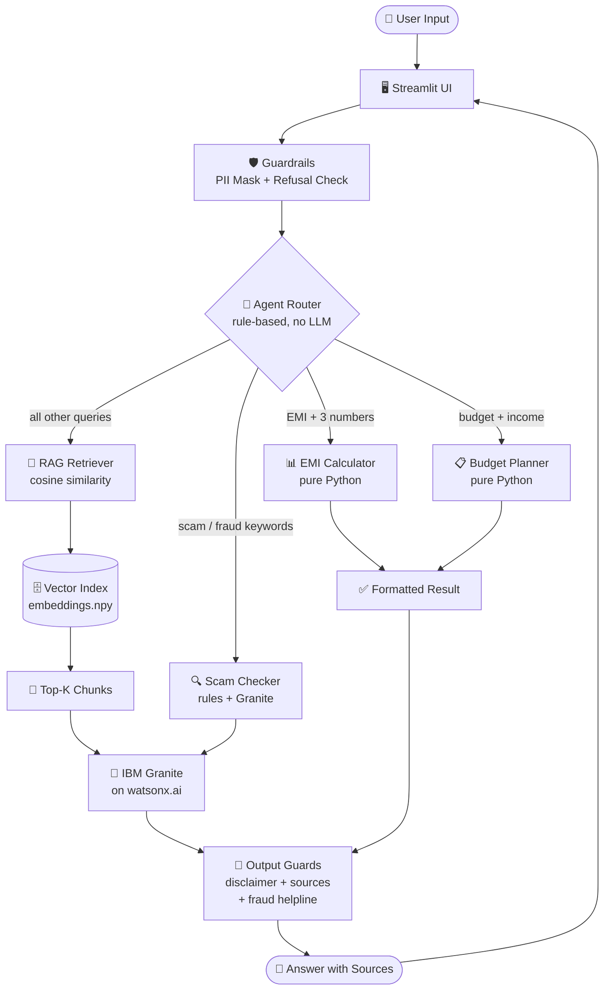
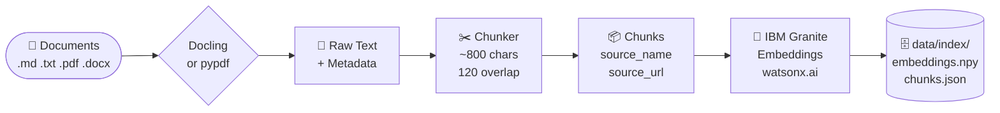

<div align="center">


# 💰 FinSaathi
### AI Agent for Digital Financial Literacy

**Empowering India's first-time digital users with safe, grounded financial guidance**

[](https://python.org)
[](https://streamlit.io)
[](https://www.ibm.com/watsonx)
[](LICENSE)
[](tests/)
[](docs/architecture.md)

---

*Ask questions about UPI · Detect scams · Calculate EMIs · Plan budgets · Available in Hindi*

</div>

---

## 📋 Table of Contents

- [What is FinSaathi?](#-what-is-finsaathi)
- [Features](#-features)
- [Architecture](#-architecture)
- [Tech Stack](#-tech-stack)
- [Quick Start](#-quick-start)
- [Getting IBM Credentials](#-getting-ibm-watsonx-credentials-free)
- [Configuration](#-configuration)
- [Project Structure](#-project-structure)
- [How It Works](#-how-it-works)
- [Knowledge Base](#-knowledge-base)
- [Responsible AI](#-responsible-ai)
- [Running Tests](#-running-tests)
- [Troubleshooting](#-troubleshooting)
- [Contributing](#-contributing)
- [License](#-license)

---

## 🌟 What is FinSaathi?

**FinSaathi** ("Fin" + "Saathi" = *Financial Friend*) is a RAG-based AI assistant designed specifically for Indian users who are new to digital banking and financial services. It runs on **IBM Granite models** via **watsonx.ai** and provides:

- ✅ **Grounded answers** — every response cites official sources (RBI, NPCI, SEBI)
- 🔒 **Privacy-first** — Aadhaar, PAN, card numbers and OTPs are masked before reaching any model
- 🚨 **Scam detection** — rule-based + AI-explained risk scoring for suspicious messages
- 🧮 **Financial tools** — EMI calculator and budget planner with no LLM dependency
- 🌐 **Hindi support** — responds in simple Devanagari when selected
- 🤖 **Mock mode** — runs fully offline without any IBM credentials (for demos and testing)

> **Note:** This is an educational tool, not a financial advisor. Always verify information with official sources.

---

## ✨ Features

| Feature | Description |
|---|---|
| 💬 **RAG Chat** | Ask anything about UPI, scams, loans, savings — answers grounded in official docs |
| 🔍 **Scam Checker** | Paste any suspicious SMS/WhatsApp message and get a risk score with explanation |
| 📊 **EMI Calculator** | Reducing-balance EMI formula with total interest breakdown |
| 📋 **Budget Planner** | 50/30/20 rule split with personalized tips |
| 🌐 **Hindi Language** | Full app in simple Hindi with financial terms kept in English |
| 🛡️ **PII Masking** | Auto-detects and masks Aadhaar, PAN, card numbers, OTPs |
| 🤖 **Mock Mode** | Works without IBM credentials — perfect for demos |
| 📚 **Source Citations** | Every RAG answer shows its source documents with links |
| 🔄 **Live Index Rebuild** | Rebuild the knowledge index from the UI sidebar |

---

## 🏗️ Architecture

### Online Inference Pipeline



### Offline Ingestion Pipeline



> See [`docs/architecture.md`](docs/architecture.md) for the Responsible AI section.

---

## 🛠️ Tech Stack

| Layer | Technology | Purpose |
|---|---|---|
| **UI** | [Streamlit](https://streamlit.io) | Chat, Scam Checker, Calculators |
| **LLM** | IBM Granite (`ibm/granite-4-h-small`) | Text generation |
| **Embeddings** | IBM Granite (`ibm/granite-embedding-278m-multilingual`) | Semantic search |
| **SDK** | `ibm-watsonx-ai >= 1.0` | watsonx.ai API client |
| **Vector Store** | NumPy (cosine similarity) | No Chroma/FAISS/LangChain |
| **Document Parsing** | Docling (optional) / pypdf (fallback) | PDF/DOCX ingestion |
| **Config** | python-dotenv | Environment variables |
| **Testing** | pytest | 56 tests, runs fully offline |

---

## 🚀 Quick Start

### Prerequisites
- Python 3.10 or higher
- IBM Cloud account (free Lite plan — [sign up here](https://cloud.ibm.com/registration))

### Setup

```bash
# 1. Clone the repository
git clone https://github.com/shiv9956/FinSaathi.git
cd FinSaathi

# 2. Create and activate a virtual environment
python -m venv .venv

# Windows
.venv\Scripts\activate

# macOS / Linux
source .venv/bin/activate

# 3. Install dependencies
pip install -r requirements.txt

# 4. Set up credentials
copy .env.example .env        # Windows
# cp .env.example .env        # macOS/Linux
# Edit .env — add WATSONX_API_KEY and WATSONX_PROJECT_ID

# 5. Verify everything works
python scripts/check_setup.py

# 6. Build the knowledge index
python -m src.ingest

# 7. Run the app
streamlit run app.py
```

Open **http://localhost:8501** in your browser.

> **No credentials?** Set `MOCK_MODE=true` in `.env` to run the full app with simulated responses — no IBM account needed.

---

## 🔑 Getting IBM watsonx Credentials (Free)

<details>
<summary><b>Click to expand step-by-step instructions</b></summary>

### Step 1 — Create an IBM Cloud account
Go to **https://cloud.ibm.com/registration** — no credit card needed for the Lite plan.

### Step 2 — Get your API Key
1. Log in at **https://cloud.ibm.com**
2. Click your profile icon → **Manage** → **Access (IAM)**
3. In the left sidebar → **API keys** → **Create an IBM Cloud API key**
4. Name it (e.g. `finsaathi-key`) → **Create**
5. **Copy immediately** — shown only once
6. Paste as `WATSONX_API_KEY=` in your `.env`

### Step 3 — Create a watsonx.ai project
1. Go to **https://dataplatform.cloud.ibm.com/wx/home**
2. **New project** → **Create an empty project** → name it `FinSaathi`
3. Open the project → **Manage** tab → copy the **Project ID**
4. Paste as `WATSONX_PROJECT_ID=` in your `.env`

### Step 4 — Associate Watson Machine Learning
1. Inside your project → **Manage** → **Services & integrations**
2. **Associate service** → **Add** → **Watson Machine Learning** (Lite = free)
3. Click **Associate**

> **Region note:** If not in US South, update `WATSONX_URL` — options are `https://eu-de.ml.cloud.ibm.com` (Frankfurt) or `https://jp-tok.ml.cloud.ibm.com` (Tokyo).

</details>

---

## ⚙️ Configuration

Copy `.env.example` to `.env` and fill in your values:

```env
WATSONX_API_KEY=your_ibm_cloud_api_key_here
WATSONX_PROJECT_ID=your_watsonx_project_id_here
WATSONX_URL=https://us-south.ml.cloud.ibm.com
GEN_MODEL_IDS=ibm/granite-4-h-small,meta-llama/llama-3-3-70b-instruct
EMBED_MODEL_ID=ibm/granite-embedding-278m-multilingual
MOCK_MODE=false
```

| Variable | Description | Default |
|---|---|---|
| `WATSONX_API_KEY` | IBM Cloud API Key | *(required for real mode)* |
| `WATSONX_PROJECT_ID` | watsonx.ai Project ID | *(required for real mode)* |
| `WATSONX_URL` | Regional watsonx endpoint | `https://us-south.ml.cloud.ibm.com` |
| `GEN_MODEL_IDS` | Comma-separated fallback model list — first usable model wins | `ibm/granite-4-h-small,...` |
| `EMBED_MODEL_ID` | Embedding model ID | `ibm/granite-embedding-278m-multilingual` |
| `MOCK_MODE` | `true` = offline simulation, no credentials needed | `false` |

> **Model IDs change over time.** If a model stops working, run `python scripts/check_setup.py` — it auto-detects available models and lists them.

---

## 📁 Project Structure

```
FinSaathi/
│
├── 📄 app.py                        ← Streamlit UI (3 tabs)
├── ⚙️  config.py                     ← All settings loaded from .env
├── 📋 requirements.txt               ← Core dependencies
├── 📋 requirements-optional.txt      ← Docling (optional PDF parser)
├── 🔐 .env.example                   ← Credential template
│
├── 📂 src/
│   ├── 🤖 watsonx_client.py          ← IBM SDK wrapper (generate + embed + mock)
│   ├── 📥 ingest.py                  ← Load docs → chunk → embed → save index
│   ├── 🔎 retriever.py               ← Cosine similarity search over embeddings
│   ├── 🛡️  guardrails.py              ← PII masking, refusals, disclaimers
│   ├── 🔧 tools.py                   ← EMI calc, budget planner, scam checker
│   └── 🧠 agent.py                   ← Rule-based router connecting everything
│
├── 📂 data/
│   ├── 📚 knowledge_base/            ← 10 Markdown knowledge files
│   └── 🗄️  index/                    ← Generated: embeddings.npy + chunks.json
│
├── 📂 scripts/
│   └── 🔍 check_setup.py             ← End-to-end IBM connection verifier
│
├── 📂 tests/                         ← 56 pytest tests (run offline)
│   ├── test_tools.py
│   ├── test_guardrails.py
│   ├── test_ingest.py
│   ├── test_retriever.py
│   └── test_agent.py
│
└── 📂 docs/
    ├── 🏗️  architecture.md            ← Mermaid diagrams + Responsible AI
    └── 🎬 demo_script.md             ← 60-90 second demo walkthrough
```

---

## 🔬 How It Works

### 1. Document Ingestion (`src/ingest.py`)

```
Knowledge Base (.md / .pdf / .docx)
         │
         ▼ Docling or pypdf
    Raw Text + Metadata
         │
         ▼ Chunk (~800 chars, 120 overlap, paragraph-aware)
    List of Chunks [{text, source_name, source_url, file}]
         │
         ▼ IBM Granite Embeddings (batched, cached)
    embeddings.npy  +  chunks.json
```

Run ingestion:
```bash
python -m src.ingest
```

### 2. Query Routing (`src/agent.py`)

The agent uses **simple regex rules** (no extra LLM call) to route each message:

```
User message
    │
    ├─ Contains "scam" / "fraud" / pasted SMS → Scam Checker + RAG explanation
    ├─ Contains "EMI" / "loan" + 3 numbers   → EMI Calculator + LLM explanation
    ├─ Contains "budget" / "salary" + number → Budget Planner + LLM tips
    └─ Everything else                        → RAG: retrieve → Granite → answer
```

### 3. RAG Pipeline (`src/retriever.py`)

```python
query → embed_query() → cosine_similarity(query_vec, all_chunk_vecs)
      → top-k chunks (score ≥ 0.25 threshold)
      → build prompt with <context> block
      → Granite generates grounded answer
      → guardrails append disclaimer + sources + fraud helpline
```

### 4. Scam Checker (`src/tools.py`)

Rule-based scoring across 12 weighted indicators:

| Indicator | Weight |
|---|---|
| Requests OTP / PIN | 25 |
| QR-code / collect-request trick | 25 |
| Fake KYC or account-block threat | 20 |
| Shortened / suspicious URL | 20 |
| Requests card details | 20 |
| Urgency language | 10 |
| Prize / lottery / job-fee claim | 15 |
| *(+ 5 more indicators)* | |

Score 0–19 → **Low** · 20–49 → **Medium** · 50–100 → **High**

Granite then explains the verdict in plain language (or simple Hindi).

### 5. Guardrails (`src/guardrails.py`)

**Input masking** (before any model sees the text):
- Aadhaar (12-digit `XXXX XXXX XXXX` pattern)
- PAN card (`ABCDE1234F` format)
- Payment card numbers (13–19 digits)
- OTP/PIN patterns (keyword + digits)

**Output enrichment** (appended to every response):
- Educational disclaimer
- Source citations with links
- Fraud helpline (1930 + cybercrime.gov.in) for fraud-related queries

---

## 📚 Knowledge Base

The `data/knowledge_base/` folder contains **10 curated Markdown files**:

| File | Topic |
|---|---|
| `01_upi_how_it_works.md` | UPI mechanics, safe payment steps, collect requests |
| `02_common_scams.md` | Fake KYC, OTP theft, QR trick, phishing, loan/job scams |
| `03_what_to_do_if_defrauded.md` | Call 1930, report at cybercrime.gov.in, bank block |
| `04_interest_rates_emi_credit.md` | Simple vs compound interest, APR, credit score |
| `05_budgeting_50_30_20.md` | 50/30/20 rule, emergency fund, budgeting tips |
| `06_savings_fd_rd_ppf.md` | FD, RD, PPF overview and comparison |
| `07_digital_banking_safety.md` | PIN/OTP safety, ATM tips, SIM swap, 2FA |
| `08_hindi_glossary.md` | Hindi translations of 20+ financial terms |
| `09_investing_basics.md` | Beginner investing principles, SEBI-regulated products |
| `10_loans_borrowing.md` | Loan types, EMI guidelines, predatory lenders |

Every file has front-matter with `source_name` and `source_url` from official sources only:
`npci.org.in` · `rbi.org.in` · `rbikehtahai.rbi.org.in` · `cybercrime.gov.in` · `sebi.gov.in`

**For production:** Drop official PDFs from RBI/NPCI/SEBI into `data/knowledge_base/` and re-run `python -m src.ingest`. The README note in the project reminds you of this.

---

## 🤝 Responsible AI

FinSaathi is built with responsible AI principles at every layer:

| Principle | Implementation |
|---|---|
| **Grounded answers** | Model instructed to answer only from retrieved context; says "I don't know" otherwise |
| **No hallucination** | Score threshold (0.25) discards low-relevance retrievals |
| **PII protection** | Aadhaar, PAN, card, OTP masked before any model or log sees them |
| **No investment advice** | Rule-based refusal routes to SEBI-registered advisor guidance |
| **No legal advice** | Rule-based refusal routes to legal professional guidance |
| **Fraud helpline** | 1930 and cybercrime.gov.in surfaced on every fraud-related answer |
| **Disclaimers** | Every response ends with "Educational information only — not financial advice" |
| **Transparency** | Mock mode is clearly bannered; simulated responses never presented as real |
| **Data minimisation** | No user conversations stored; no personal data collected or logged |
| **Human escalation** | Always recommends official channels for critical decisions |

---

## 🧪 Running Tests

Tests run **entirely offline** in mock mode — no IBM credentials needed:

```bash
# Windows PowerShell
$env:MOCK_MODE="true"; pytest tests/ -v

# macOS / Linux
MOCK_MODE=true pytest tests/ -v
```

**56 tests across 5 test files:**

| Test File | What It Tests |
|---|---|
| `test_tools.py` | EMI formula, budget split, scam scoring (25 tests) |
| `test_guardrails.py` | PII masking, refusals, output post-processing (13 tests) |
| `test_ingest.py` | Chunking size, overlap, metadata, edge cases (7 tests) |
| `test_retriever.py` | Search results, scores, k-limit (4 tests) |
| `test_agent.py` | Routing to each tool, Hindi mode, always returns dict (8 tests) |

---

## 🔧 Troubleshooting

| Problem | Solution |
|---|---|
| `Auth error: 401 Unauthorized` | Check `WATSONX_API_KEY` and `WATSONX_PROJECT_ID` in `.env` — no extra spaces |
| `Model not found` / model ID invalid | Models get deprecated. Run `python scripts/check_setup.py` to list available models, then update `GEN_MODEL_IDS` |
| `Quota exceeded` on Lite plan | Wait for quota reset. The embedding cache (`data/index/embed_cache.json`) prevents re-embedding unchanged chunks |
| Docling install fails | Skip it — use `pip install -r requirements.txt` only. App auto-falls back to `pypdf` |
| `Index not found` error in UI | Run `python -m src.ingest` to build the index first |
| App starts in MOCK_MODE unexpectedly | Confirm `.env` exists with non-empty `WATSONX_API_KEY` and `WATSONX_PROJECT_ID`. Check `MOCK_MODE=false` |
| `ibm-watsonx-ai` version error | Run `pip install ibm-watsonx-ai --upgrade`. Version 1.0+ required |
| Hindi responses in English | Ensure the language dropdown in the sidebar is set to Hindi before asking |
| Scam checker not flagging obvious scam | The message may use different phrasing. Paste the exact message text including all keywords |

---

## 🤝 Contributing

Contributions are welcome! Areas that benefit most:

- **Knowledge base expansion** — add official PDFs from RBI/SEBI/NPCI
- **More scam patterns** — add new indicator regexes in `src/tools.py`
- **More languages** — extend system prompts in `src/agent.py`
- **UI improvements** — enhance the Streamlit layout in `app.py`

```bash
# Run tests before submitting a PR
$env:MOCK_MODE="true"; pytest tests/ -v
```

---

## 📄 License

MIT License — see [LICENSE](LICENSE) for details.

Knowledge base content is for **educational purposes only**. This is not financial advice. Always verify information with official sources:

- 🏦 RBI: https://www.rbi.org.in
- 💳 NPCI: https://www.npci.org.in
- 📈 SEBI: https://www.sebi.gov.in
- 🚨 Cybercrime Helpline: **1930** · https://cybercrime.gov.in

---

<div align="center">

**Built with ❤️ for India's digital financial inclusion**

*Powered by [IBM Granite](https://www.ibm.com/granite) on [watsonx.ai](https://www.ibm.com/watsonx)*

</div>
