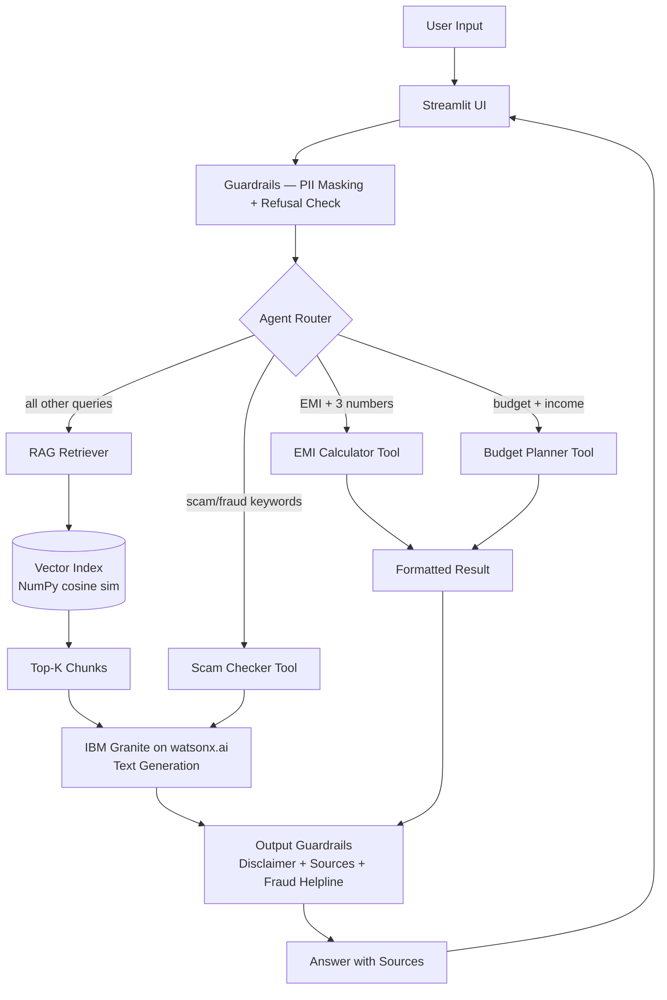
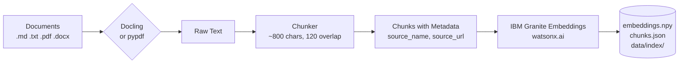

# FinSaathi Architecture

## System Overview

FinSaathi is a RAG-based financial literacy assistant for Indian users, powered by IBM Granite models on watsonx.ai.

## Online Inference Pipeline

## Offline Ingestion Pipeline

## Component Roles

| Component | Role |
|---|---|
| `app.py` | Streamlit UI — chat, scam checker, calculators |
| `config.py` | All settings from `.env` |
| `src/watsonx_client.py` | IBM SDK wrapper — generate + embed, mock mode |
| `src/ingest.py` | Document loading, chunking, index building |
| `src/retriever.py` | Cosine similarity search over embeddings |
| `src/guardrails.py` | PII masking, refusal checks, output disclaimers |
| `src/tools.py` | EMI calculator, budget planner, scam checker |
| `src/agent.py` | Router — connects retriever + tools + LLM |

---

## Responsible AI

### Grounded Answers with Citations
Every answer generated by the RAG path is grounded strictly in retrieved knowledge-base chunks. The model is explicitly instructed to say it doesn't know if the context is insufficient. Sources are displayed as expandable citations under each answer.

### PII Masking
Before any text reaches the model, the guardrails module scans for and masks Aadhaar numbers (12-digit patterns), PAN card numbers (ABCDE1234F format), payment card numbers (13-19 digits), and OTP/PIN patterns. A warning is shown to the user when masking occurs.

### No Investment or Legal Advice
Rule-based refusal prevents the model from being used for stock/crypto/mutual-fund investment advice or legal advice. Users are directed to SEBI-registered advisors and legal professionals respectively.

### Disclaimers
Every response ends with a clearly marked disclaimer: *"Educational information only — not financial advice."* Fraud-related answers always include the National Cybercrime Helpline (1930) and cybercrime.gov.in.

### Fraud Helpline Surfacing
When the user's question or the model's response contains fraud/scam keywords, the response automatically appends: "If you have been defrauded: Call 1930 immediately and report at cybercrime.gov.in."

### Human Escalation Guidance
The system always recommends escalating to official channels (1930, cybercrime.gov.in, SEBI, RBI) rather than relying solely on AI guidance for critical situations.

### Transparency About Mock Mode
When running without real IBM credentials (MOCK_MODE=true), a persistent banner is shown in the UI and all mock responses are clearly labeled. This prevents users from trusting simulated responses.

### Data Minimisation
The system never stores user conversations. No personal data is collected, logged, or retained between sessions. The privacy note in the sidebar reminds users never to enter sensitive information.
